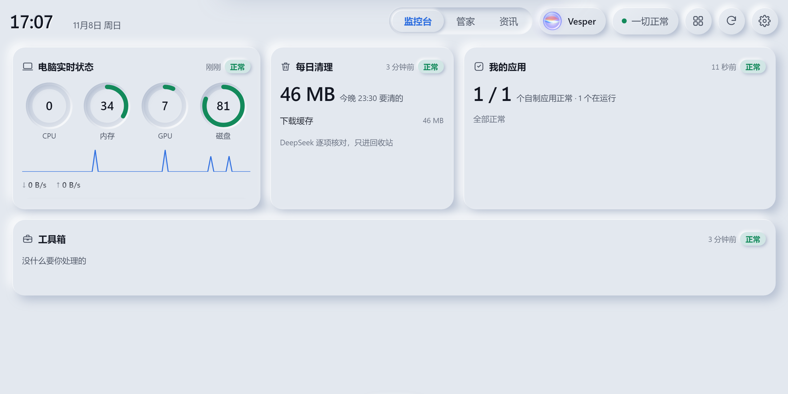

# v0.3.0 · Windows 版 + 英文模式 / Deck for Windows + English mode
## 下载 / Download

**Windows**：下载下面 **Assets** 里的 **`Deck-Setup-0.3.0.exe`**，双击安装（装在用户文件夹，不要管理员权限）。安装包没有代码签名，Windows 弹「已保护你的电脑」时点 **更多信息 → 仍要运行**。说明见 [docs/windows.md](https://github.com/3520566741-YCLi/deck-for-mac/blob/main/docs/windows.md)。
**Windows**: download **`Deck-Setup-0.3.0.exe`** under **Assets** below and run it (installs into your user folder, no admin rights). The installer isn't code-signed; if Windows says it protected your PC, click **More info → Run anyway**. See [docs/windows.en.md](https://github.com/3520566741-YCLI/deck-for-mac/blob/main/docs/windows.en.md).

**Mac**：在 **Assets** 里下载 **Source code (zip)**，解压后按 [AI_SETUP.md](https://github.com/3520566741-YCLi/deck-for-mac/blob/main/AI_SETUP.md) 安装（可以直接交给你的 AI 助手照着装）。已经装过旧版：看 [AI_SETUP.md 第 10 节「更新到新版本」](https://github.com/3520566741-YCLi/deck-for-mac/blob/main/AI_SETUP.md#10-更新到新版本)。
**Mac**: download **Source code (zip)** under **Assets**, unzip, and follow [AI_SETUP.en.md](https://github.com/3520566741-YCLi/deck-for-mac/blob/main/AI_SETUP.en.md) (you can hand it to your AI assistant). Already on an older version: see section 10 of AI_SETUP, "Updating".

---

Deck 有 Windows 版了（带安装包），还有英文模式。
Deck now runs on Windows (with an installer), and has an English mode.

### 新增 / Added

- **Windows 版**：只有新拟态皮肤，Release 里有安装包 `Deck-Setup-0.3.0.exe`，装在用户文件夹、不要管理员权限。说明见 [docs/windows.md](https://github.com/3520566741-YCLi/deck-for-mac/blob/main/docs/windows.md)。
  **Windows version**: neumorphic skin only, with an installer `Deck-Setup-0.3.0.exe` on the Release; installs into your user folder, no admin rights. See [docs/windows.en.md](https://github.com/3520566741-YCLi/deck-for-mac/blob/main/docs/windows.en.md).
  - 主页、管家页、进程、磁盘面板、工具箱、每日清理、键盘清洁、资讯页、助手对话都能用，数据和任务管理器同源；所有「删除」只进回收站，能一键放回。
    Home, Butler, processes, disk panel, toolbox, daily cleanup, keyboard cleaning, news and the assistant all work, with data from the same source as Task Manager; every "delete" only goes to the Recycle Bin and can be put back.
  - **顶部面板**（刘海模式的 Windows 版）：鼠标碰屏幕顶边正中弹出，移开收起，全屏游戏和视频时不弹；托盘里切换 自动 / 窗口 / 顶部面板。
    **Top panel** (the Windows take on notch mode): touch the middle of the top edge to open it, move away to close; never pops over full-screen games or video. Switch Auto / Window / Top panel from the tray.
  - **语音**：唤醒、识别、朗读都在本机；Ctrl+Alt+M 开关麦克风，按住 Ctrl+Alt+J 说话。模型第一次启动自动下载并校验。
    **Voice**: wake word, recognition and speech all run locally; Ctrl+Alt+M toggles the mic, hold Ctrl+Alt+J to talk. Models download and are verified on first start.
  - **让助手操作电脑**：默认关；Ctrl+Alt+Esc 立刻停；不碰密码框、管理员窗口和凭据管理器，危险操作先问。
    **Let the assistant use the PC**: off by default; Ctrl+Alt+Esc stops it at once; never touches password boxes, admin windows or Credential Manager, and asks before anything risky.
  - API key 存进 Windows 凭据管理器（`cmdkey /generic:deepseek-api /user:deck /pass`），不写进文件。
    API keys go into Windows Credential Manager (`cmdkey /generic:deepseek-api /user:deck /pass`), never into a file.
  - 每次改动都在 GitHub 的 Windows 云电脑上自动测试、截图、打包（[windows.yml](https://github.com/3520566741-YCLi/deck-for-mac/blob/main/.github/workflows/windows.yml)）。
    Every change is tested, screenshotted and packaged on a GitHub Windows cloud machine ([windows.yml](https://github.com/3520566741-YCLi/deck-for-mac/blob/main/.github/workflows/windows.yml)).
- **英文模式**：设置 → 外观 → 语言（跟随系统 / 中文 / English），也可以让助手切。监控台、管家页、资讯页都翻译了；聊天原文和日报正文保持原样。
  **English mode**: Settings → Appearance → Language (Follow system / 中文 / English), or ask the assistant. Dashboard, Butler and News are translated; chat messages and the brief's text stay as written.

### 改动 / Changed

- 助手收起时的提示音换成和开启音相配的「从高往低」版本。
  The assistant's closing chime is now a falling version of its opening chime.

### 修复 / Fixed

- 第一次打开就关掉了几张卡时，主页会留空洞：现在会自动排紧。
  Turning off cards before the layout was ever saved left gaps on the home page; it now packs the cards.

### 更新 / Updating

- **Mac**：拉取新代码后重启 Deck（退出 Deck → 结束 8777 上的 server.py → 重新打开），见 [AI_SETUP.md 第 10 节](https://github.com/3520566741-YCLi/deck-for-mac/blob/main/AI_SETUP.md#10-更新到新版本)。
  **Mac**: pull the new code and restart Deck (quit Deck → stop server.py on port 8777 → reopen); see section 10 of [AI_SETUP.en.md](https://github.com/3520566741-YCLi/deck-for-mac/blob/main/AI_SETUP.en.md).
- **Windows**：下载 Release 里的 `Deck-Setup-0.3.0.exe` 安装。
  **Windows**: download and run `Deck-Setup-0.3.0.exe` from the Release.

所有旧版本都保留在 [Releases](https://github.com/3520566741-YCLi/deck-for-mac/releases)。 / Every earlier version stays on the Releases page.
