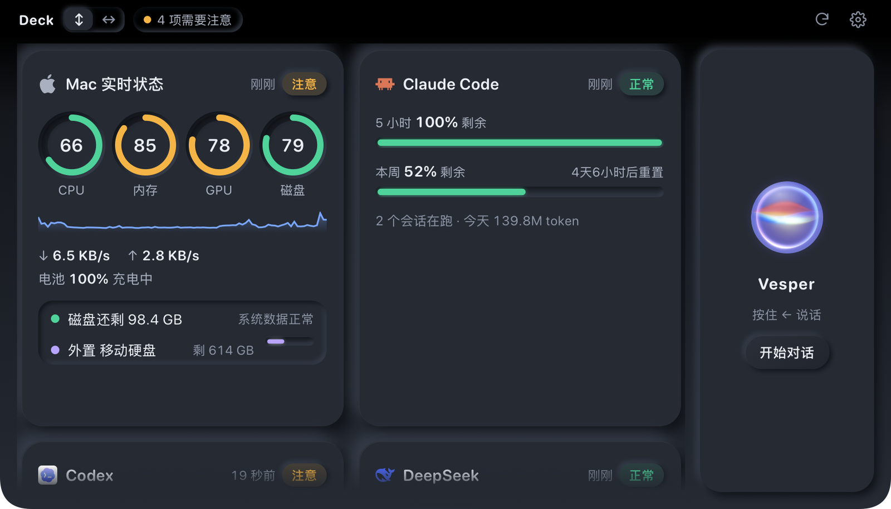

<div align="center">


# Deck

**A free, open-source butler for your MacBook: an always-on dashboard plus a local-first voice assistant.**

[中文](README.md) · **English**


</div>

> The interface is in Chinese for now. Your AI can translate the UI strings while it sets Deck up for you.

## What it does

| | Feature | In one line |
|---|---|---|
| 🖥️ | **Dashboard** | A local web page shown on an external screen or an old iPad, or dropped down from the MacBook notch (⌥Space). Neumorphic skin, automatic day / night, cards you can drag and resize. |
| 📊 | **Live status** | CPU, memory, GPU, disk, network, top processes; Claude Code / Codex quota left; DeepSeek balance; GitHub repos. Each card answers one question. |
| 💽 | **Disk watch** | Tap the disk ring: what is growing, what was added recently, who is writing to the disk. |
| 🎙️ | **Voice assistant** | Wake it by name. Speech recognition and synthesis run on your Mac; only the "brain" is a cloud LLM. A voiceprint makes sure only you can wake or interrupt it. It reads card data, opens cards, searches the web and can click things for you. |
| 🗞️ | **News page** | A personal tech paper three times a day: frontier tech, trending open source, AI labs, art × code, and news on your watchlist (Longbridge Securities as the example broker). Capped at about ¥1 a day. |
| 🧹 | **Toolbox + daily cleanup** | Uninstall apps with leftovers, clear caches, find large and duplicate files, update apps. **Everything goes to the Trash, nothing is deleted outright**, and one tap puts it back. |

<table>
<tr>
<td></td>
<td></td>
</tr>
<tr>
<td></td>
<td></td>
</tr>
<tr>
<td></td>
<td></td>
</tr>
</table>

## How to install: hand it to your AI

Deck has several parts (a Python service, a web page, small Swift apps, local voice models) and every Mac is different, so there is no one-click installer. Instead there is a **step-by-step guide written for AI coding assistants**.

1. Open your AI coding assistant (Claude Code, Codex, Cursor…) and let it work on your Mac.
2. Send it this:

   > Read `AI_SETUP.en.md` in https://github.com/3520566741-YCLi/deck-for-mac and install Deck on my Mac step by step. Check my machine and ask me what I want first.

3. Answer its questions (which cards, which LLM, voice or not, the assistant's name). **Never paste an API key into the chat**; it will give you one command to store the key in the macOS Keychain yourself.

You can also follow [AI_SETUP.en.md](AI_SETUP.en.md) by hand; every step has its commands.

## Requirements

- A Mac with Apple silicon (M1 or later). Voice needs macOS 14+; the system Liquid Glass assistant panel needs macOS 26+ (older systems get a web-drawn panel).
- An LLM API key for the assistant. The default is [DeepSeek](https://platform.deepseek.com/); any OpenAI-compatible API with streaming and tool calls works.
- About 3 GB of disk for local voice models.
- Every outside service is listed in [docs/services.en.md](docs/services.en.md), with what we found on 2026-11-07 and how to re-check it.

## Principles

- **Local first**: wake word, voiceprint, recognition, synthesis and data collection all run on your Mac. Recordings and voiceprints never leave it.
- **Localhost only**: every service listens on 127.0.0.1; writes need a random token and a same-origin request; DNS rebinding is blocked.
- **No idle spending**: the LLM is called only when you talk, click, or at times you set.
- **Ask before acting**: cleanup, killing processes and clicking all show a confirmation first.
- **Trash, never delete**: every removal is a move to the Trash and can be undone.

## Layout

```
manager/            Butler service (Python stdlib, :8777) + dashboard page
  monitor/          Data collectors for each card
  assistant.py      Assistant: chat, tools, long-term memory
  newsroom/         News page (free sources → one DeepSeek editing pass)
  voice/            Voice: DeckVoice.app (Swift) + voice service (Python, sherpa-onnx)
  hands/            DeckHands.app: clicks through the Accessibility API
app/                Deck.app native shell (SwiftPM): fills an external screen / drops from the notch
scripts/            Claude status line bridge, UI self-check script
docs/               Service list, voice latency notes, screenshots
```

## Docs

- [AI_SETUP.en.md](AI_SETUP.en.md): install and configuration guide for your AI
- [docs/services.en.md](docs/services.en.md): outside services, how to verify them, the Longbridge example
- [docs/voice-latency.en.md](docs/voice-latency.en.md): how the voice loop answers in 2–3 seconds
- [SECURITY.md](SECURITY.md): security design and how to report a problem
- [CHANGELOG.md](CHANGELOG.md): release notes

## License

[MIT](LICENSE). Third-party parts (GridStack, React Bits, UI sounds, voice models) keep their own licenses; see [THIRD_PARTY_NOTICES.md](THIRD_PARTY_NOTICES.md).
