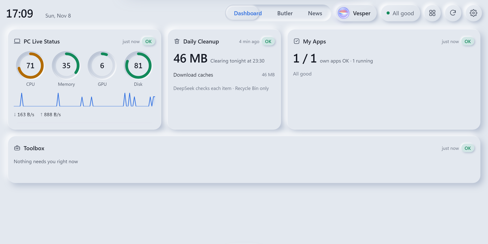
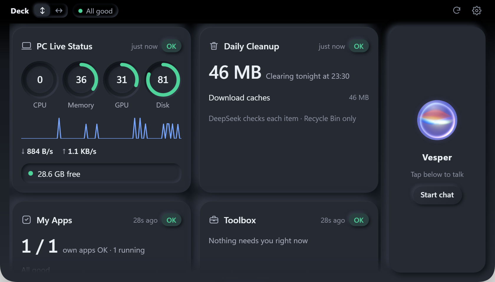
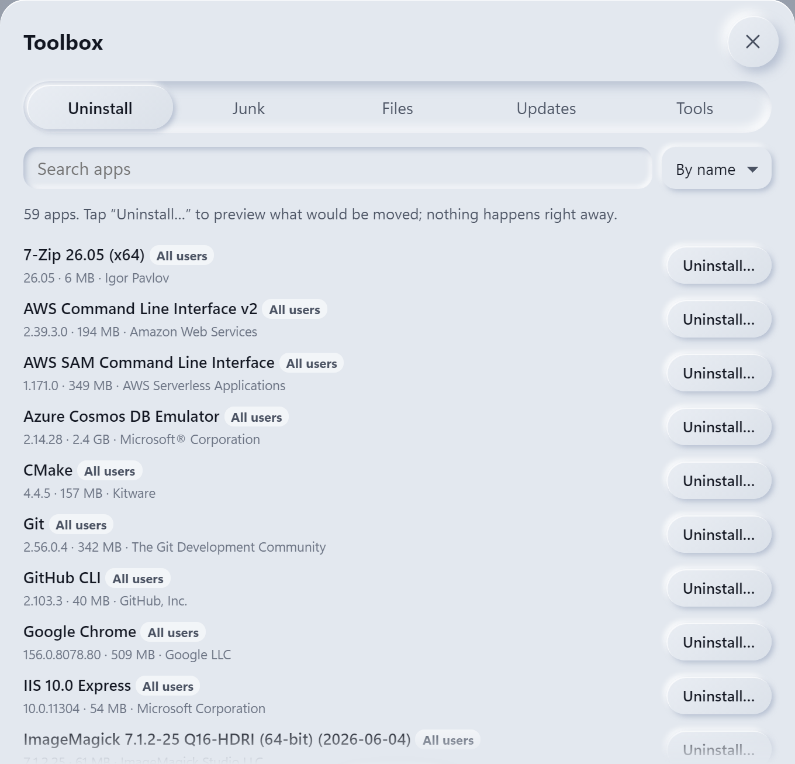
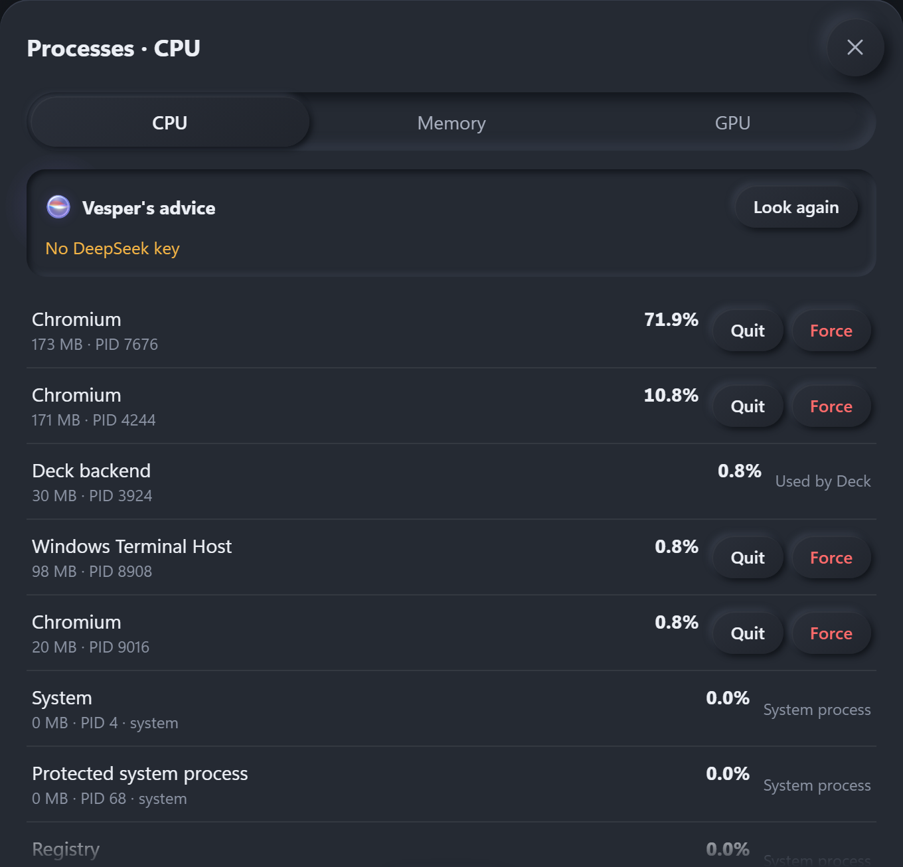
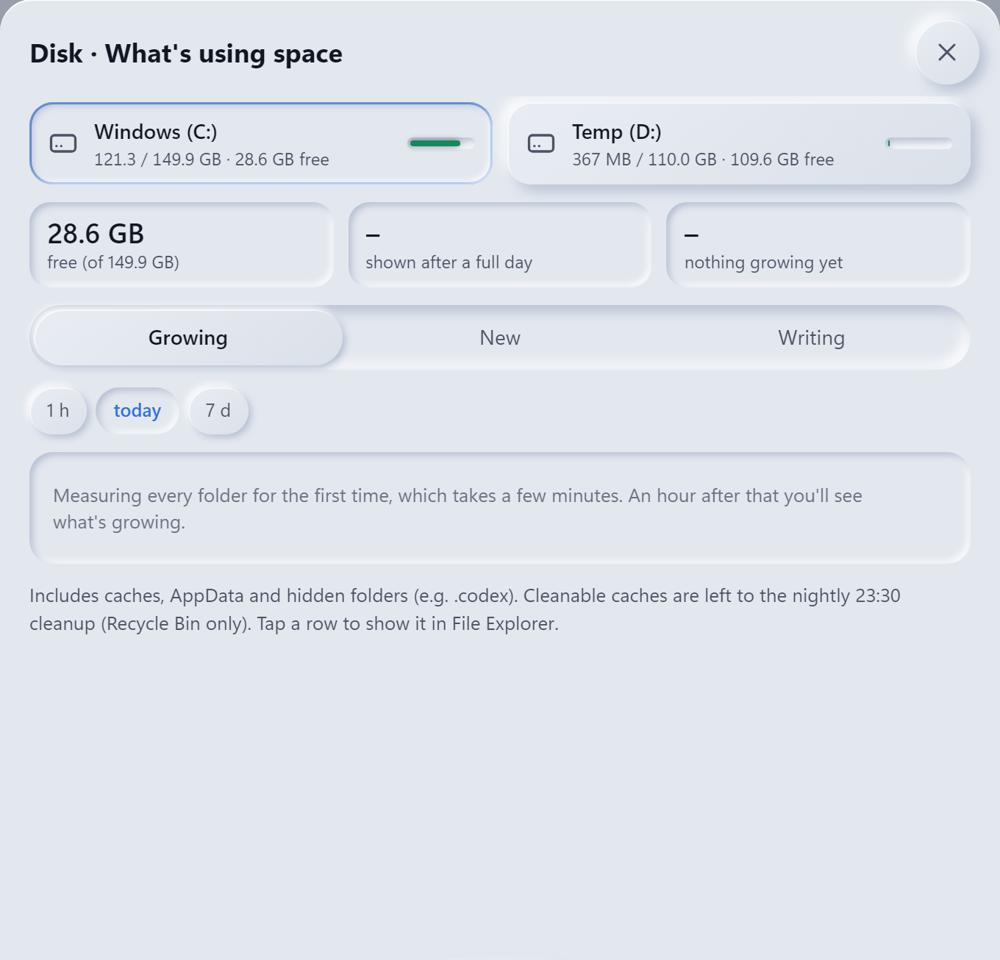
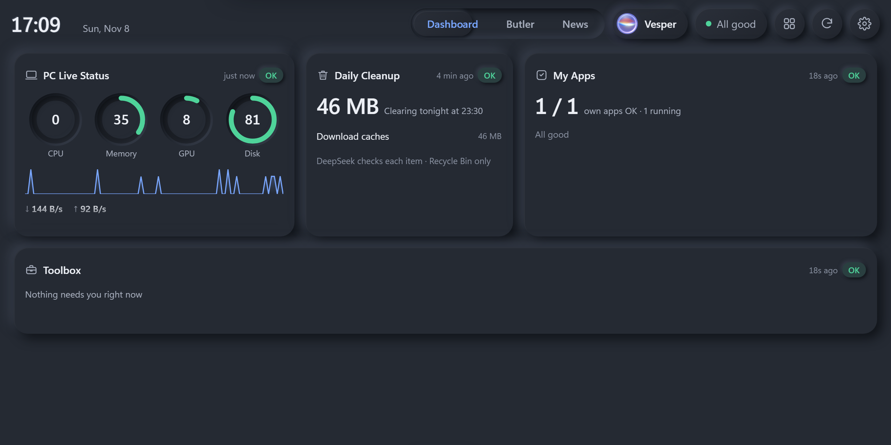

# Deck for Windows

<p><a href="windows.md">中文</a> · <b>English</b></p>

The Windows version of Deck: the same web UI and the same Python backend as the Mac version, with the **neumorphic** skin only. The Mac's notch mode becomes the **top panel** on Windows, sliding down from the middle of the top edge of the screen.

Unlike the Mac version, Windows has an **installer**: double-click it and you're done, no AI-guided setup needed.



## Download and install

1. Open the [latest release](https://github.com/3520566741-YCLi/deck-for-mac/releases/latest) and download **`Deck-Setup-<version>.exe`** under **Assets**.
2. Run it. It installs into your own user folder (`%LOCALAPPDATA%\Programs\Deck`) and **needs no admin rights**. You can tick "Start with Windows".
3. The installer isn't code-signed, so Windows may say "Windows protected your PC": click **More info → Run anyway**. If you'd rather not, see [Build it yourself](#build-it-yourself).
4. Deck lives in the system tray. Click the tray icon to open it; **Ctrl+Alt+Space** brings it up any time.

**Requirements**: Windows 10 / 11 (64-bit, x64 or ARM64). The UI uses the built-in Edge WebView2; on very old systems install Microsoft's [WebView2 Runtime](https://developer.microsoft.com/microsoft-edge/webview2/). Voice needs about 400 MB of disk for models.

**Updating**: install the new version over the old one; settings and data are kept. **Uninstalling**: Settings → Apps → Deck → Uninstall. Your data in `%APPDATA%\Deck` is left alone.

## What it does

| | Feature | On Windows |
|---|---|---|
| 🖥️ | Dashboard | A window, full screen, or the **top panel** (touch the middle of the top edge to open it, move away to close; never pops over full-screen games or video). Tray → Display mode: Auto / Window / Top panel. "Auto" fills a second screen when one is connected, otherwise uses the top panel |
| 📊 | PC live status | CPU, memory, GPU, disk, network, from the same source as Task Manager; plugged-in USB drives are listed too |
| 💽 | Disk panel | What's growing, what's new, who's writing |
| 🧹 | Toolbox, daily cleanup | Uninstall apps with leftovers, junk cleanup, large and duplicate files, winget updates, keyboard cleaning. **Recycle Bin only**, and Deck can put things back in one click; USB drives, drives with the Recycle Bin off, and anything bigger than the bin are never touched |
| 🗂️ | Butler | Whether the apps you registered are running or crashing (Windows Error Reporting), startup tasks, dead taskbar shortcuts |
| 🎙️ | Voice assistant | Say its name, or **Ctrl+Alt+M** to toggle the mic and **hold Ctrl+Alt+J** to talk. Recognition, speech, wake word and voiceprint all run locally (sherpa-onnx); models download from the official k2-fsa releases on first start (about 375 MB, SHA-256 checked), or from Settings |
| 🖐️ | Let the assistant use the PC | Reads buttons, clicks, types and presses shortcuts through Windows UI Automation. **Off by default**: turn it on in Settings or the tray; **Ctrl+Alt+Esc** stops it at once. Never types into password boxes, never touches admin windows or Credential Manager; asks first before deleting, sending, paying or shutting down |
| 🗞️ | News page; Claude Code / Codex / GitHub / DeepSeek cards | Same as on the Mac |
| 🌐 | Chinese and English | Switch the web UI in Settings → Appearance → Language; the tray menu and installer follow the Windows display language |

### Screenshots

| Top panel | Toolbox |
|:---:|:---:|
|  |  |
| **Processes (night)** | **Disk panel** |
|  |  |



> The screenshots come from a real run on a GitHub Windows cloud machine (retaken automatically for each release). That machine has no Claude Code, Codex, DeepSeek or GitHub account, so those cards are turned off in Settings.

## Connect a language model (for the assistant and the news page)

The API key goes into Windows **Credential Manager** (the Windows counterpart of the Mac Keychain), never into a file. Open PowerShell, paste this line, press Enter and paste your key when asked (it isn't shown or saved in history):

```powershell
cmdkey /generic:deepseek-api /user:deck /pass
```

Then quit Deck from the tray and open it again. Run the line again to replace the key; to remove it: `cmdkey /delete:deepseek-api`.

[DeepSeek](https://platform.deepseek.com/) is the default. To use another provider, change the model, or set up the news page and stocks, see [AI_SETUP.en.md](../AI_SETUP.en.md); on Windows the `config.json` file lives in the install folder under `_internal\manager\`.

## Differences from the Mac version

- Neumorphic skin only; no Liquid Glass, wired iPad sound effects, or LAN / tablet access.
- No echo cancellation: to interrupt the assistant while it's talking, say "stop". There is one voice (Kokoro, female).
- Shortcuts: Ctrl+Alt+Space (show), Ctrl+Alt+M (mic), hold Ctrl+Alt+J (talk), Ctrl+Alt+Esc (stop PC control).
- Data lives in `%APPDATA%\Deck`, logs in `%LOCALAPPDATA%\Deck\logs`.

## Build it yourself

On Windows, with Python 3.12 and [Inno Setup 6](https://jrsoftware.org/isinfo.php):

```powershell
git clone https://github.com/3520566741-YCLi/deck-for-mac.git
cd deck-for-mac
pip install -r windows/requirements-build.txt
python windows/deck_win.py                       # run straight from source
pyinstaller windows/deck.spec --noconfirm        # builds dist\Deck\Deck.exe
iscc /DAppVersion=0.3.0 windows\installer.iss    # builds dist\Deck-Setup-0.3.0.exe
```

You can preview the Windows web UI on a Mac or Linux too: `cd manager && DECK_OS=win python3 server.py` (needs `pip install psutil`).

## How it's tested

Every change to `manager/` or `windows/` runs on a Windows cloud machine in [GitHub Actions](../.github/workflows/windows.yml): a backend self-test; a real transparent always-on-top window for the top panel; test files really moved to the Recycle Bin and restored; a test notepad whose buttons are read, typed into and clicked; the voice service and model download; reading a key from Credential Manager; light / dark × Chinese / English screenshots checked for Mac wording, overlapping cards and overflowing text; and finally the build, with the packaged exe tested again.
