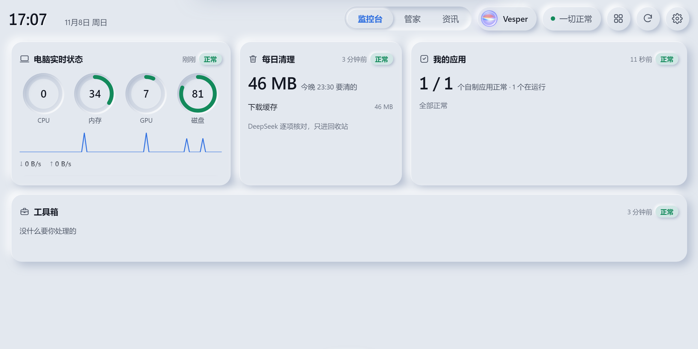
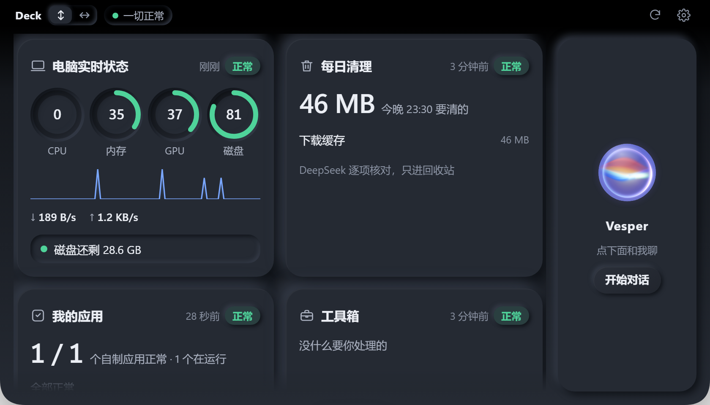
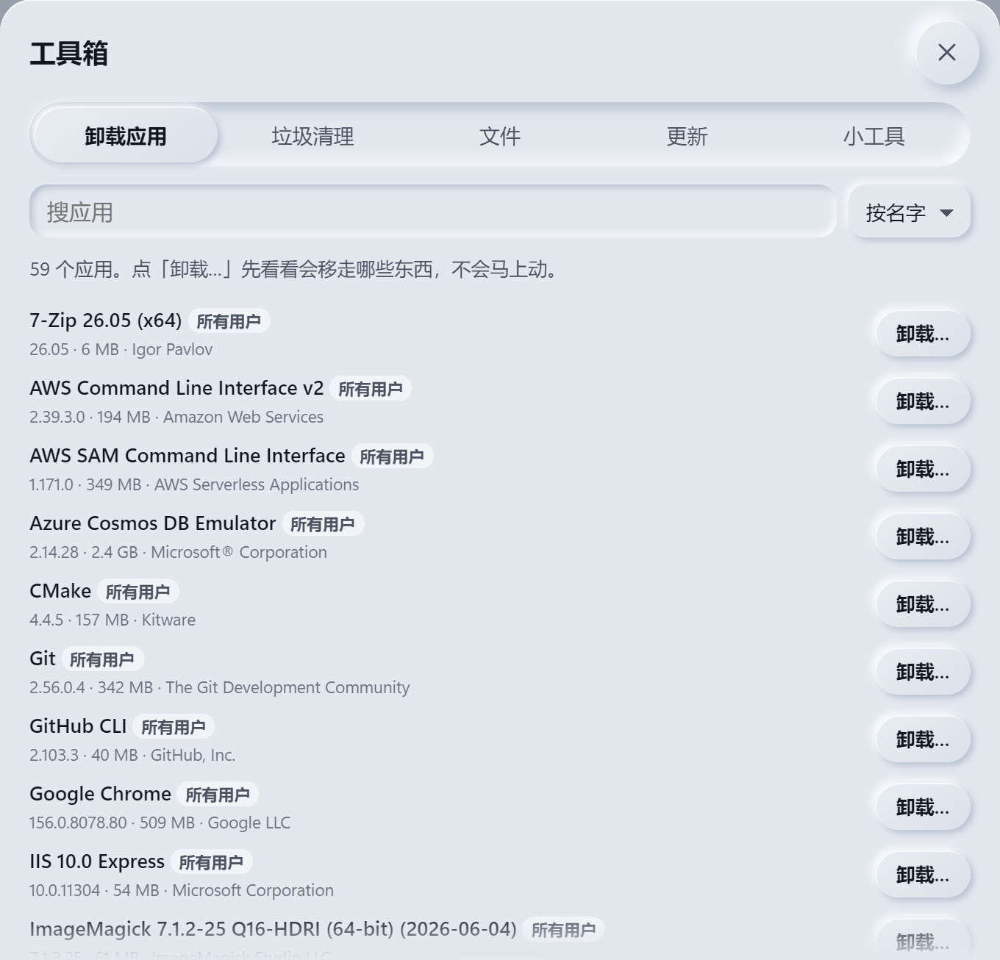
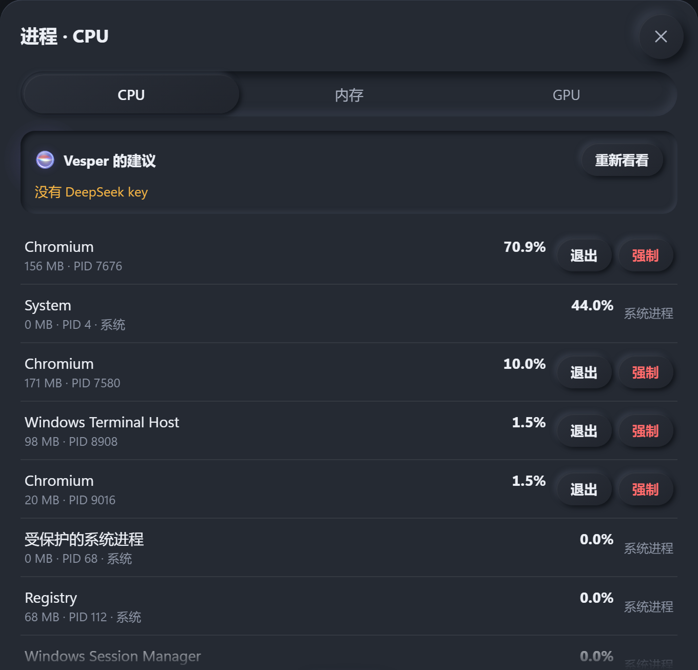
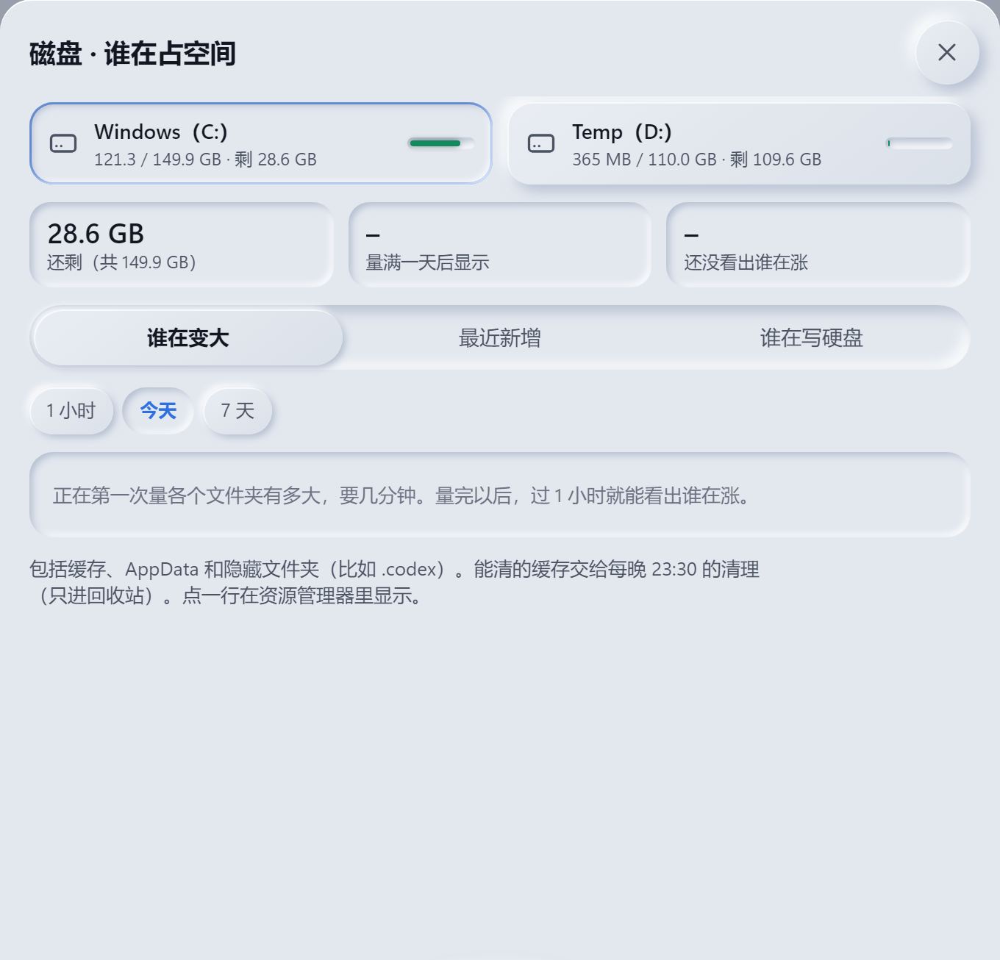
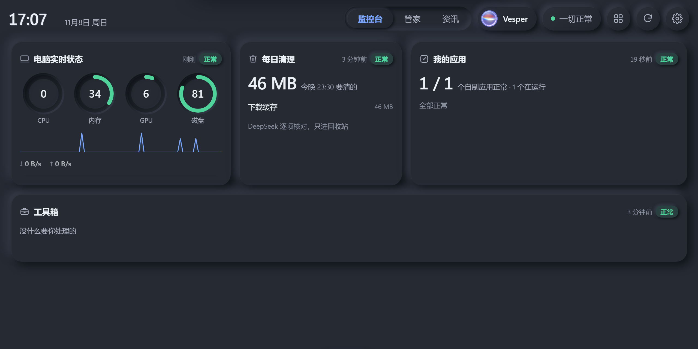

# Deck for Windows

<p><b>中文</b> · <a href="windows.en.md">English</a></p>

Deck 的 Windows 版：和 Mac 版同一套网页、同一个 Python 后台，只有**新拟态**皮肤。Mac 上的刘海模式在 Windows 上叫**顶部面板**，从屏幕顶边正中流下来。

和 Mac 版不一样，Windows 版有**安装包**，双击装好就能用，不用交给 AI 一步步配。



## 下载和安装

1. 打开 [最新版 Release](https://github.com/3520566741-YCLi/deck-for-mac/releases/latest)，在 **Assets** 里下载 **`Deck-Setup-<版本>.exe`**。
2. 双击安装。装在你自己的用户文件夹里（`%LOCALAPPDATA%\Programs\Deck`），**不要管理员权限**。可以勾「开机自动启动」。
3. 安装包没有代码签名，Windows 可能弹「Windows 已保护你的电脑」：点 **更多信息 → 仍要运行**。不放心可以看 [自己打包](#自己打包) 一节，从源码打一个。
4. 装好后 Deck 在右下角托盘。点托盘图标打开；**Ctrl+Alt+空格** 随时呼出。

**需要**：Windows 10 / 11（64 位，x64 或 ARM64）。系统自带的 Edge WebView2 用来显示界面；极老的系统缺它的话装一下微软的 [WebView2 运行时](https://developer.microsoft.com/microsoft-edge/webview2/)。语音要约 400 MB 磁盘放模型。

**更新**：下载新版安装包直接装在上面，设置和数据都保留。**卸载**：设置 → 应用 → Deck → 卸载；你的数据在 `%APPDATA%\Deck`，卸载不会动它。

## 能做什么

| | 功能 | Windows 上 |
|---|---|---|
| 🖥️ | 控制台 | 窗口、全屏、或者**顶部面板**（鼠标碰屏幕顶边正中就弹出，移开收起；全屏游戏和视频时不弹）。托盘 → 显示方式：自动 / 窗口 / 顶部面板。「自动」= 接着第二块屏就铺满那块屏，没接就用顶部面板 |
| 📊 | 电脑实时状态 | CPU、内存、GPU、磁盘、网速，和任务管理器同源；插着的 U 盘、移动硬盘也列出来 |
| 💽 | 磁盘面板 | 谁在变大、最近新增、谁在写硬盘 |
| 🧹 | 工具箱、每日清理 | 卸载应用连残留、垃圾清理、大文件和重复文件、winget 查更新、键盘清洁。**只进回收站**，Deck 里能一键放回；U 盘、关了回收站的盘、比回收站还大的东西一律不动 |
| 🗂️ | 管家页 | 你登记的应用在不在跑、崩没崩（Windows 错误报告）、开机任务、任务栏失效图标 |
| 🎙️ | 语音助手 | 喊名字唤醒，或者 **Ctrl+Alt+M** 开关麦克风、**按住 Ctrl+Alt+J** 直接说。识别、合成、唤醒、声纹都在本机（sherpa-onnx）；模型第一次启动自动从 k2-fsa 官方下载（约 375 MB，校验 SHA-256），设置里也能手动下载 |
| 🖐️ | 让助手操作电脑 | 用 Windows 的 UI 自动化读按钮、点、打字、按快捷键。**默认关**，在设置或托盘里打开；**Ctrl+Alt+Esc** 立刻停。不往密码框打字，不碰管理员窗口和凭据管理器；删除、发送、付款、关机先问你 |
| 🗞️ | 资讯页、Claude Code / Codex / GitHub / DeepSeek 卡 | 和 Mac 版一样 |
| 🌐 | 中英文 | 网页在设置 → 外观 → 语言里切；托盘菜单和安装向导跟 Windows 的显示语言 |

### 截图

| 顶部面板 | 工具箱 |
|:---:|:---:|
|  |  |
| **进程（夜里）** | **磁盘面板** |
|  |  |



> 截图是 GitHub 的 Windows 云电脑上真跑出来的（每次发版自动重拍）。云电脑上没有 Claude Code、Codex、DeepSeek、GitHub 账号，这几张卡在设置里关掉了。

## 接上大模型（助手、资讯页要用）

API key 存进 Windows 的**凭据管理器**（相当于 Mac 的钥匙串），不写进任何文件。打开 PowerShell，粘贴这一行，回车后按提示粘贴 key（不会显示，也不进命令历史）：

```powershell
cmdkey /generic:deepseek-api /user:deck /pass
```

然后在托盘里退出 Deck 再打开。想换掉 key 就再跑一遍；想删掉：`cmdkey /delete:deepseek-api`。

默认用 [DeepSeek](https://platform.deepseek.com/)。想用别家、改模型、配资讯页和股票，见 [AI_SETUP.md](../AI_SETUP.md)，Windows 上配置文件 `config.json` 放在安装目录的 `_internal\manager\` 里。

## 和 Mac 版不一样的地方

- 只有新拟态皮肤；没有液态玻璃、iPad 有线音效、局域网 / 平板访问。
- 语音没有回声消除：助手说话时想打断，说「停」。朗读只有一个女声（Kokoro）。
- 快捷键：Ctrl+Alt+空格（呼出）、Ctrl+Alt+M（麦克风）、按住 Ctrl+Alt+J（说话）、Ctrl+Alt+Esc（停止操作电脑）。
- 数据在 `%APPDATA%\Deck`，日志在 `%LOCALAPPDATA%\Deck\logs`。

## 自己打包

在 Windows 上，装好 Python 3.12 和 [Inno Setup 6](https://jrsoftware.org/isinfo.php)：

```powershell
git clone https://github.com/3520566741-YCLi/deck-for-mac.git
cd deck-for-mac
pip install -r windows/requirements-build.txt
python windows/deck_win.py                       # 直接从源码跑
pyinstaller windows/deck.spec --noconfirm        # 打出 dist\Deck\Deck.exe
iscc /DAppVersion=0.3.0 windows\installer.iss    # 打出 dist\Deck-Setup-0.3.0.exe
```

在 Mac / Linux 上也能看 Windows 版的网页：`cd manager && DECK_OS=win python3 server.py`（要 `pip install psutil`）。

## 怎么测的

每次改 `manager/` 或 `windows/`，[GitHub Actions](../.github/workflows/windows.yml) 都在 Windows 云电脑上跑一遍：后台自检；真开一个透明置顶窗口测顶部面板；真把测试文件移进回收站再撤销；开一个测试记事本读按钮、打字、点菜单；语音服务和模型下载；凭据管理器读 key；白天 / 夜里 × 中文 / 英文截图，检查没有 Mac 的说法、卡片不重叠、文字不溢出；最后打包，打包出来的 exe 再测一遍。
